# Getitresolved — AI-Powered Citizen Complaint Management System

**Getitresolved** is an enterprise-grade municipal citizen complaint management and triage system. It empowers citizens to report civic issues, leverages AI with deterministic fallback for categorization and department routing, scores issues across four objective impact metrics, highlights severe conditions with strictly thresholded star indicators, and provides dedicated role-based operational dashboards for Citizens, Department Staff, and Municipal Administrators.

---

## 1. Architecture & Technologies

- **Frontend:** React 18, TypeScript, Tailwind CSS, Vite, Lucide Icons, React Router DOM.
- **Backend:** Node.js, Express, TypeScript, Zod validation, JWT with HTTP-only cookies, Multer (5MB limit, 3 photo max).
- **Database:** PostgreSQL with Prisma ORM, migrations, and idempotent database seeding.
- **AI Classification Engine:** Pluggable AI integration (Gemini/OpenAI) with deterministic keyword & heuristic rule-based fallback when keys are absent or services time out.
- **Single-Origin Production Model:** Express serves both the compiled Vite SPA assets (`dist/client`) and REST API (`/api`), ensuring no CORS issues, proper SPA route fallback, and instant deployment.
- **Testing:** Built-in `node:test` + TypeScript test runner for unit and integration testing; Playwright with headless Chromium for browser journeys.

---

## 2. Seeded Demo Accounts & Credentials

The system comes pre-seeded with realistic fictional data covering all categories, lifecycles, and scoring combinations. You can test each role using these credentials or use the **"Demo Logins"** 1-click fill button in the application navbar:

| Role | Account Name | Email Address | Password | Permissions & Queue Scope |
| :--- | :--- | :--- | :--- | :--- |
| **Administrator** | Elena Rostova | `admin@civicresolve.gov` | `Admin123!` | System overview, all complaints, manual review queue, score overrides, staff assignment, audit history. |
| **Staff (Roads)** | Marcus Vance | `staff.roads@civicresolve.gov` | `Staff123!` | Roads & Public Works queue (potholes, asphalt damage, sidewalks). |
| **Staff (Electrical)** | Sophia Chen | `staff.electrical@civicresolve.gov` | `Staff123!` | Electrical & Streetlighting queue (dark streets, pole damage, wiring). |
| **Staff (Water)** | David Okafor | `staff.water@civicresolve.gov` | `Staff123!` | Water Supply queue (pipe bursts, pressure drops, contamination). |
| **Staff (Drainage)** | Amara Patel | `staff.drainage@civicresolve.gov` | `Staff123!` | Drainage & Sewage queue (clogged catch basins, sewer stench). |
| **Staff (Sanitation)** | Liam O’Connor | `staff.sanitation@civicresolve.gov` | `Staff123!` | Sanitation queue (illegal dumping, overflowing public trash). |
| **Citizen** | Jane Doe | `citizen.jane@example.com` | `Citizen123!` | Submit complaints with photos, track status, view department assignments and progress notes. |
| **Citizen** | John Smith | `citizen.john@example.com` | `Citizen123!` | Submit complaints, track personal complaints. |

---

## 3. Application Dashboards & Visual Workflow Walkthrough

### 👤 Citizen Journey: Reporting to Transparent Resolution

| 1. Citizen Dashboard & Active Reports | 2. Incident Submission with Direct Uploads |
| :---: | :---: |
| 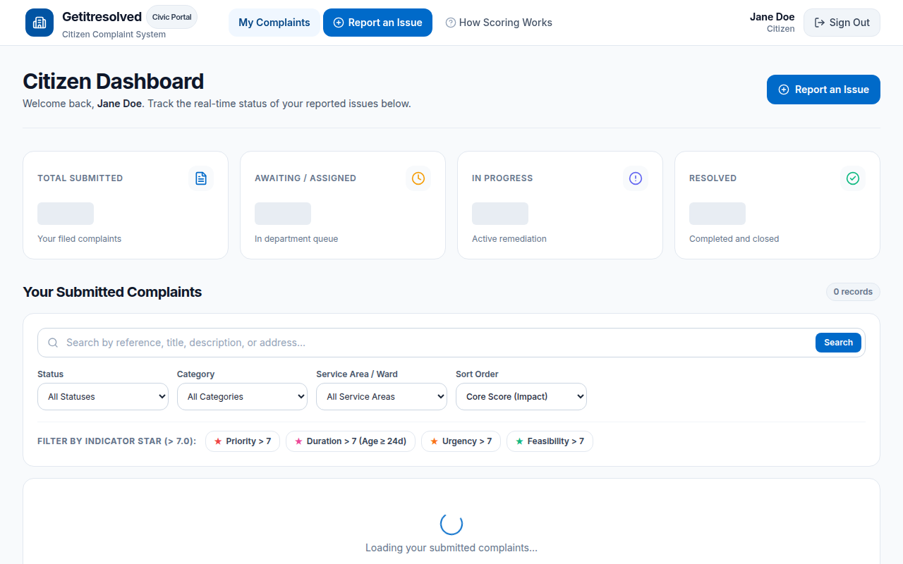 | 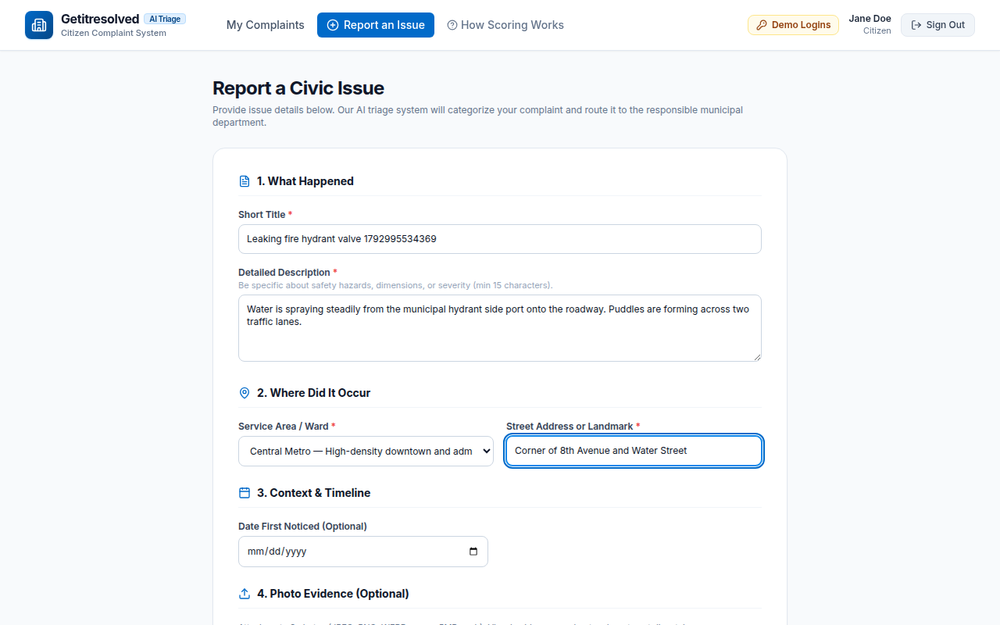 |
| *Personal dashboard with metrics, search filters, and status badges* | *Structured form with location input and private photo dropzone* |

| 3. Instant Reference Confirmation | 4. Real-time Progress & Scoring Details |
| :---: | :---: |
| 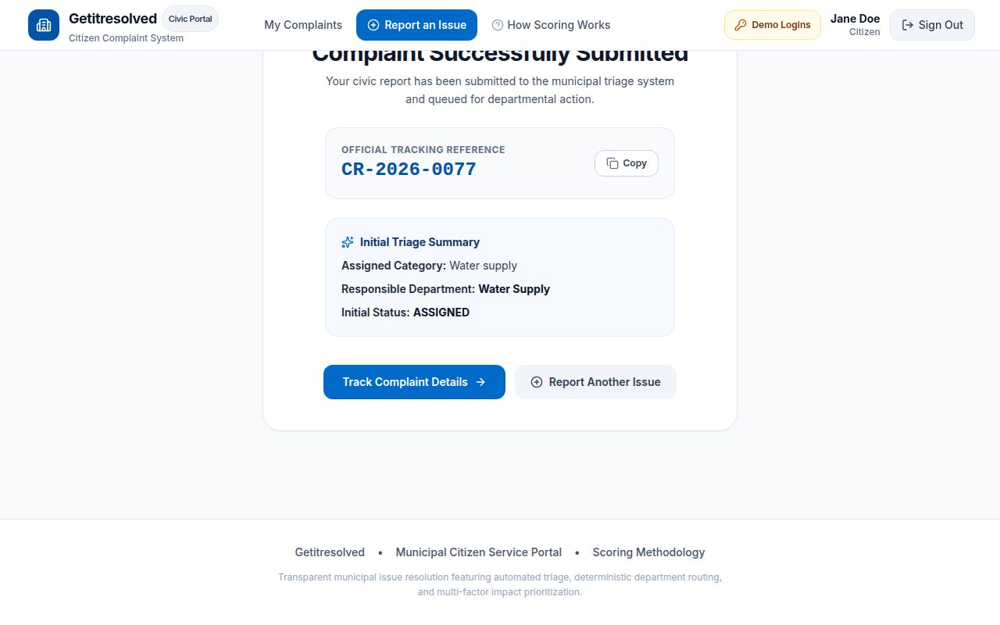 | 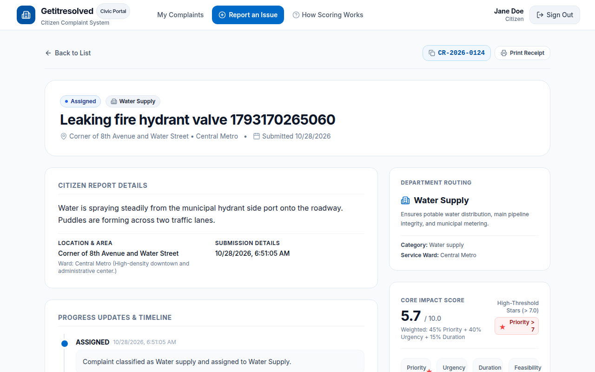 |
| *Deterministic routing reference (`CR-XXXXXX`) with 1-click copy* | *Objective 3-factor core score, star badges, timeline & notes* |

---

### 🛠️ Department Staff Operations: Triage, Progress & Resolution

| 1. Department Filtered Queue | 2. Progress Update & Citizen-Visible Notes |
| :---: | :---: |
| 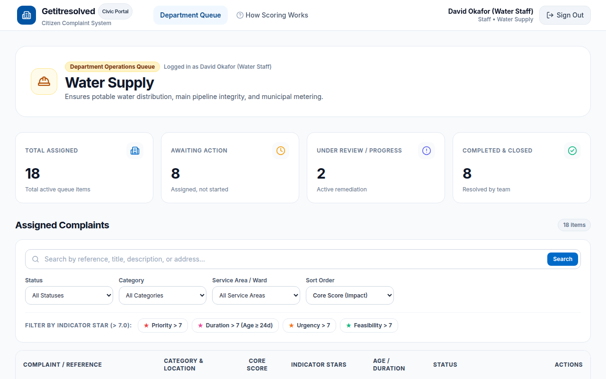 | 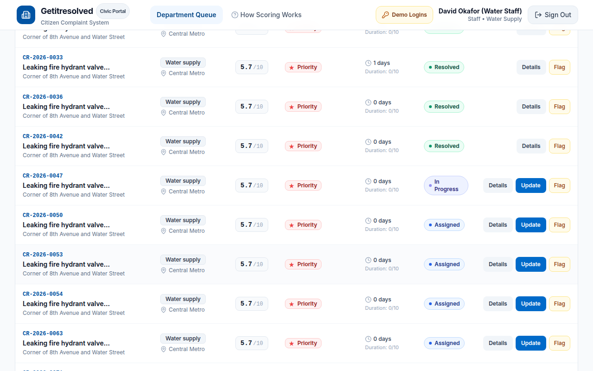 |
| *Scoped to department jurisdiction with priority/urgency sorting* | *Status transitions with required explanatory notes and audit logging* |

---

### 🏛️ Municipal Administrator Controls: Governance & Audit Trail

| 1. Executive Operations Overview | 2. AI Manual Review & Triage Queue |
| :---: | :---: |
| 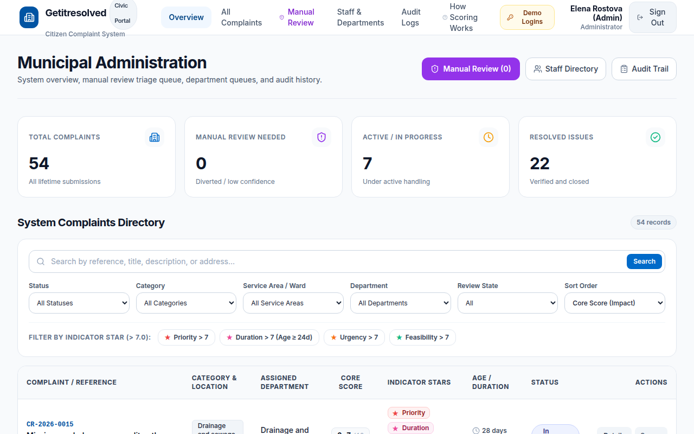 | 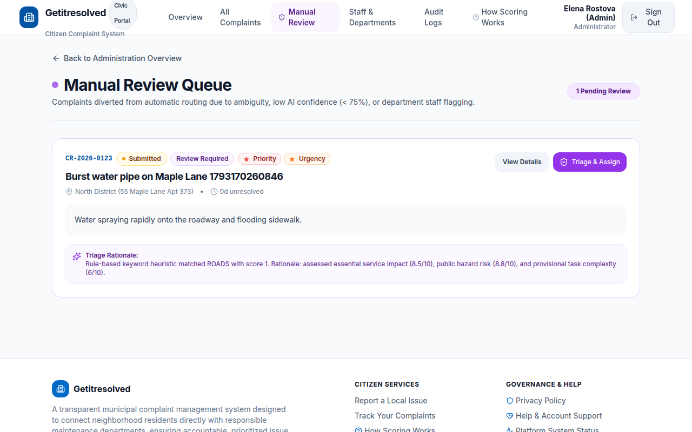 |
| *System-wide metrics, department workload, and recent activity* | *Uncertain categorization (<0.75 confidence) triage with AI diagnostics* |

| 3. Staff & Department Assignment | 4. Immutable System Audit Logs |
| :---: | :---: |
| 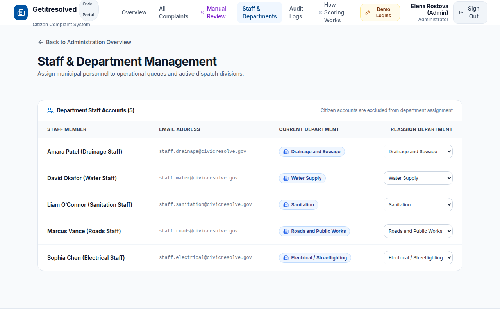 | 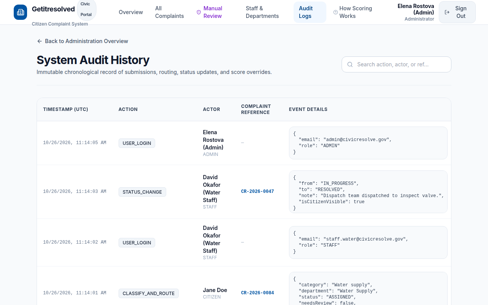 |
| *Staff directory, department roster, and permission controls* | *Comprehensive audit trail of status updates and score overrides* |

---

### 🌐 Civic Portal & Objective Scoring Guide

| Civic Landing Page (Desktop & Mobile) | Transparent Scoring & Star Indicator Guide |
| :---: | :---: |
| 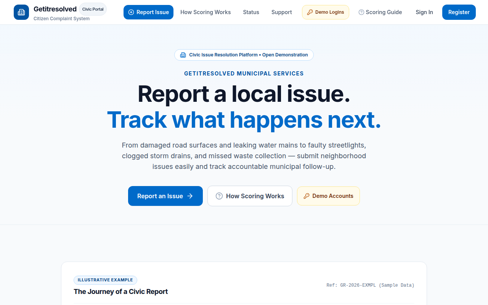 | 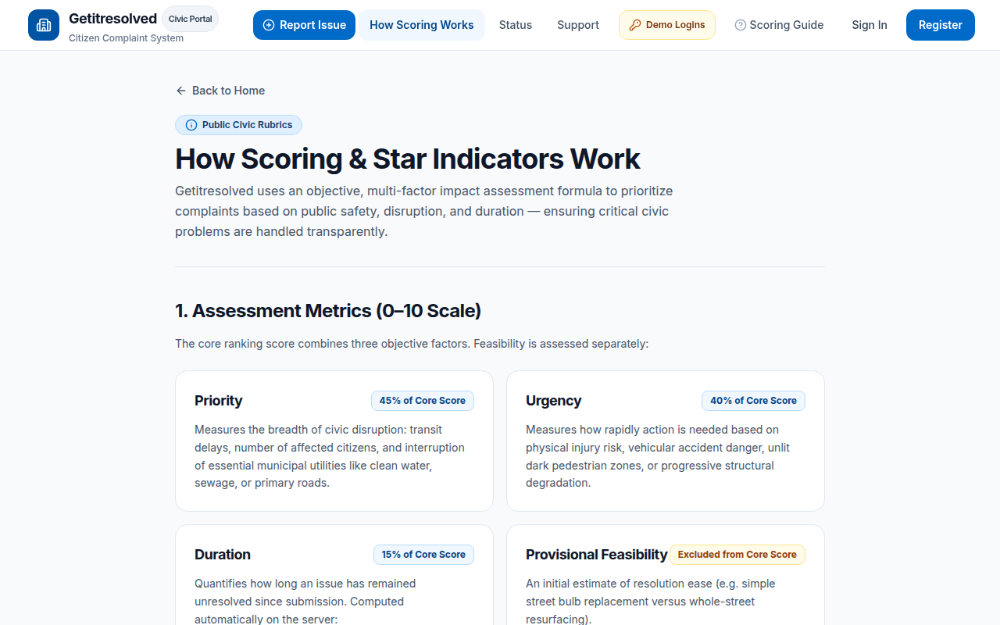 |
| *Public entry point explaining civic reporting journey* | *Full disclosure of priority, urgency, duration & star criteria* |

---

## 4. Quick Start & Startup Commands

### Prerequisites
- Node.js 20+ (Node 22 recommended)
- PostgreSQL 15+

### Installation & Run

```bash
# 1. Install dependencies
npm install

# 2. Setup database (apply migrations and seed demonstration accounts/complaints)
npm run db:setup

# 3. Build application (client and server)
npm run build

# 4. Start production server
npm start
```

The application will start on `http://0.0.0.0:5000` (or the port specified in `PORT`).

### Development Mode

```bash
# Start backend dev server with tsx watch
npm run dev:server

# In a separate terminal, start frontend Vite dev server
npm run dev:client
```

### Docker Compose (Optional)

```bash
# Start PostgreSQL and Getitresolved app container
docker compose up -d

# Check logs
docker compose logs -f app
```

---

## 5. Scoring Formulas, Rubrics & Star Indicators

Getitresolved implements four objective scores on a 0–10 scale:

1. **Priority (0–10):** Measures overall civic disruption, breadth of impacted citizens, and impact on essential municipal services (water, power, sanitation, roadways).
2. **Urgency (0–10):** Measures the speed required for intervention based on imminent pedestrian or vehicular accident risks, dark intersections, or progressive damage.
3. **Duration (0–10):** Quantifies unresolved complaint age. Calculated dynamically on the server:
   $$\text{durationScore} = \min(10, \lfloor \text{unresolvedAgeInDays} / 3 \rfloor)$$
   *(1 point per 3 days elapsed, capped at 10 points after 30 days. For resolved complaints, age is permanently frozen at `resolvedAt`).*
4. **Feasibility (0–10):** A provisional estimate of resolution ease. **Excluded from core score** so difficult, complex problems are not deprioritized.

### Overall Core Impact Score Formula:
$$\text{coreScore} = \text{round}(0.45 \times \text{priority} + 0.40 \times \text{urgency} + 0.15 \times \text{durationScore}, 1)$$

### Strict Colored Star Indicators ($> 7.0$)
A star is awarded **strictly when a score exceeds 7.0** ($> 7.0$). A score of exactly $7.0$ triggers no star:
- 🔴 **Red Star:** `effectivePriority > 7.0` (Severe public disruption / essential service outage)
- 🌸 **Pink Star:** `durationScore > 7.0` (Unresolved for more than 21 days)
- 🟠 **Orange Star:** `effectiveUrgency > 7.0` (Active accident risk / pitch-black street / emergency)
- 🟢 **Green Star:** `effectiveFeasibility > 7.0` (Provisional estimate of straightforward resolution)

*Note: Star indicators are objective triage assessment thresholds, not citizen satisfaction ratings.*

---

## 6. Department Routing & AI Fallback

- **Deterministic Routing Table:** Mapped via `Category + Service Area -> Department`. Routing logic is strictly decoupled from AI inference.
- **Predefined Categories:**
  - Roads and potholes (`ROADS`) &rarr; Roads and Public Works
  - Streetlights (`STREETLIGHTS`) &rarr; Electrical / Streetlighting
  - Water supply (`WATER`) &rarr; Water Supply
  - Drainage and sewage (`DRAINAGE`) &rarr; Drainage and Sewage
  - Garbage and sanitation (`SANITATION`) &rarr; Sanitation
  - Other / uncertain (`OTHER`) &rarr; Manual Review Queue
- **AI Fallback & Manual Triage:**
  - Real Gemini provider supported via `GEMINI_API_KEY`.
  - Transparent rule-based fallback executes when keys are absent or if the provider times out.
  - Complaints with confidence $< 0.75$, category "Other / uncertain", or missing routing mappings automatically divert to the **Administrator Manual Review Queue** with a diagnostic reason.

---

## 7. Testing & Quality Verification

Run the complete test suite:

```bash
# Run 30 Unit & Integration Tests
npm test

# Run End-to-End Browser Journeys (Playwright & Headless Chromium)
npx tsx --test tests/e2e/e2e-browser.test.ts
```

All 30 backend tests and 4 end-to-end browser journeys verify:
- Accurate duration scoring and resolved age freezing.
- Strict $> 7.0$ star threshold boundary logic.
- Cross-user and cross-department access restrictions.
- Mandatory resolution notes and explainability for state reversals.
- Automated AI fallback and manual review diversion.
- Full citizen submission &rarr; staff progress &rarr; resolution lifecycle.
- Production storage hardening, pre-uploaded attachment scoping, and credentialed CORS restriction.

---

## 8. System Architecture & Workflows

### 8.1. Complaint Lifecycle Workflow

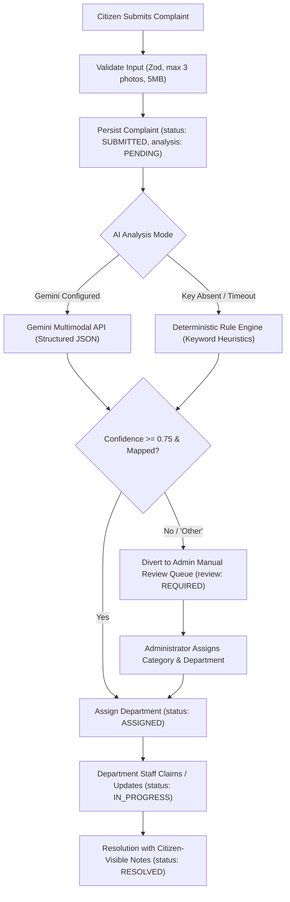

#### Lifecycle Visual Stages

| Step 1: Citizen Submission Form | Step 2: Routing & Status Tracking | Step 3: Staff Resolution with Notes |
| :---: | :---: | :---: |
|  |  |  |

### 8.2. Multi-Factor Scoring & Strict Star Thresholds

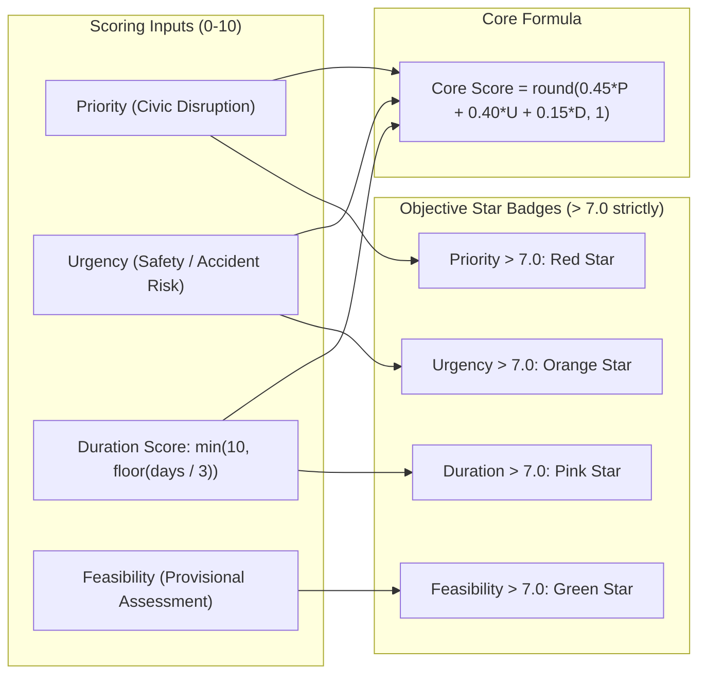

#### Scoring Interface & Transparent Assessment Guide

| Core Impact Score & Stars on Complaint Record | Public Scoring & Prioritization Guide |
| :---: | :---: |
|  |  |

### 8.3. Vercel Cloud Serverless Architecture

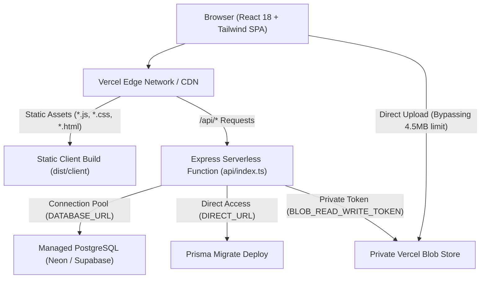

---

## 9. Production Deployment & Security Configuration

Getitresolved is configured for high-performance serverless deployment on Vercel:

- **Single-Origin Deployment:** Express handles API routes under `/api`, while Vite SPA assets (`dist/client`) and client routes are served from the edge with fallback to `/index.html`.
- **Database Connection Pooling:** Managed PostgreSQL (Neon, Supabase, or AWS RDS) uses transaction-mode pooling via `DATABASE_URL` for serverless functions, alongside `DIRECT_URL` for running migrations (`npx prisma migrate deploy`).
- **Private Object Storage:** Photos are stored in a Private Vercel Blob store (`access: 'private'`). Files are never accessible via raw unauthenticated URLs; all access is authorized and streamed through Express endpoints with strict role-based controls.
- **Direct-to-Storage Uploads:** Direct client uploads to Vercel Blob bypass the serverless 4.5 MB request payload limit while enforcing user ownership and strict file limits (max 3 images, 5 MB each).
- **Environment Isolation:** Separate Preview and Production databases, distinct session secrets, and isolated storage tokens ensure complete staging/production safety.

